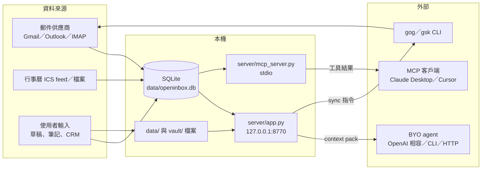

# 個人資料類別與流向盤點（RoPA-lite）

本文件列出 openinbox 處理的資料主體、個資類別、資料集與流向，作為個資法「特定目的與必要範圍」判斷與後續告知、刪除設計的基礎。

> 所有示例皆為倉庫既有的虛構資料（`*@example.com`）或明顯假值。本文件不含真實個資。

## 1. 資料主體

| 代號 | 資料主體 | 說明 | 是否為本工具使用者 |
|---|---|---|---|
| S1 | 使用者本人 | 安裝並操作 openinbox 的人；帳號、人格、草稿、偏好都屬於他 | 是 |
| S2 | 郵件寄件人 | 來信中出現的第三人 | 否 |
| S3 | 郵件收件人／副本對象 | 去信與往來信件中的第三人 | 否 |
| S4 | 行事曆與會者、邀請對象 | 事件、RSVP、邀請草稿中的第三人 | 否 |
| S5 | CRM 聯絡人 | `data/contacts.json` 中被建檔的第三人 | 否 |
| S6 | ICS feed 提供者（同事） | 匯入其行事曆的第三人 | 否 |
| S7 | BYO agent／MCP 客戶端營運者 | 收到 context pack 的外部服務 | 否（但可能是受託處理者） |

**關鍵觀察**：S2–S6 的個資是使用者「為自己的通訊目的」而蒐集，屬於個資法第 9 條的**間接蒐集**情境；使用者本人難以個別告知每一位寄件人，實務上以「社群網站、通訊軟體等公開場合」與「契約或類似契約關係」等事由處理，或以第 9 條第 2 項的例外（當事人已知、通知顯有困難等）處理。此為需要 BOB 明確決策的地方。

## 2. 個資類別

依個資法第 2 條第 1 款，「個人資料」指得以直接或間接方式識別該個人之資料。openinbox 涉及的類別：

| 類別 | 具體欄位 | 主要來源 | 是否特種個資（第 6 條） |
|---|---|---|---|
| 姓名 | `from_addr` 顯示名、`to_addr`、與會者 `name`、CRM `name` | 郵件標頭、行事曆、使用者輸入 | 否 |
| 電子郵件地址 | `from_addr`、`to_addr`、`account`、與會者 `email` | 郵件標頭、行事曆 | 否 |
| 電話、地址、傳真 | 可能出現在簽名檔或信件內文 | 郵件內文 | 否（但屬高敏感聯絡資料） |
| 任職機構與職稱 | 顯示名、簽名檔、網域、Email Brain 推論 | 郵件內文、推論 | 否 |
| 通訊內容 | 主旨、內文、引用、附件檔名 | 郵件 | 否，但**內含第三人個資** |
| 社交活動 | 行事曆事件、與會狀態（ACCEPTED／DECLINED）、free/busy | 行事曆、ICS | 否 |
| 行為與偏好側寫 | 寫信文風、收信習慣、常用寄件人、注意力焦點（`vault/persona.*`） | 本機推論 | 否，但屬**間接識別 + 行為側寫**，敏感度高 |
| 關係與商業資訊 | CRM 階段、標籤、往來次數、最近主題 | 使用者操作、本機推論 | 否 |
| 財務資訊 | 發票號碼、帳號末四碼、匯款資訊（若信中出現） | 郵件內文 | 否（非第 6 條，但應視為高敏感） |
| 病歷、醫療、健康檢查、基因、性生活、犯罪前科 | 可能在私人郵件中**偶然出現** | 郵件內文 | **是**（第 6 條，原則禁止蒐集處理利用） |
| 身分證字號、護照號碼 | 可能在辦件郵件中出現 | 郵件內文 | 非第 6 條，但屬高風險識別資料 |

### 2.1 特種個資與偶然取得的處理原則

openinbox 不主動要求任何第 6 條資料，但它會**忠實快取整封郵件**，因此可能在無意間持有。

建議原則（列為後續工程待辦，見 `ACTION-PLAN.md` P1-5）：

1. 不針對特種個資建立任何分析、標籤或摘要欄位。
2. 提供「敏感內容偵測」作為**提示**而非自動刪除，避免誤刪使用者主張的證據或健康相關通信。
3. 文件明確寫出：使用者不得以此工具大規模蒐集他人特種個資；若涉及，應自行取得第 6 條的法定事由（如法律明文、當事人書面同意等）。

## 3. 資料集清單（RoPA-lite）

### 3.1 SQLite（`data/openinbox.db`）

資料表用途依 `docs/fmb/ARCHITECTURE.md` 第 4.1 節；實際欄位需以程式碼確認 `[B]`／`[C]`。

| 資料集 | 主要欄位（推論） | 個資類別 | 來源 | 目的 | 清除行為 | 證據 |
|---|---|---|---|---|---|---|
| `emails` | `id`、`account`、`thread_id`、`from_addr`、`to_addr`、`subject`、`date_raw`、`body_text`／`snippet`、`has_attachment` | 姓名、Email、通訊內容、機構 | S1–S3 郵件同步 | 本機快取以支援收件匣、搜尋、摘要 | 「清除本機快取」會移除郵件快取 | `[B]` |
| `mail_state` | 資料夾、已讀、星號等本機覆寫 | 行為資料（間接） | 使用者操作 | 保持一致的使用者狀態 | 未列於清除清單，推論保留 | `[C]` |
| `events`／行事曆相關 | 標題、起訖、時區、與會者、RSVP、地點 | 姓名、Email、社交活動 | 使用者、Agent、ICS | 統一行事曆與 free/busy | 示範／快取行事曆會被清；本機建立與匯入 feed 保留 | `[B]` |
| `cal_feeds` | feed 來源、事件、UID | 第三人行程 | S6 | 同事行程檢視 | 保留（有 `POST /api/cal/feed/delete`） | `[B]` |
| `drafts` | 收件人、主旨、內文 | S2–S3、通訊內容 | 使用者、Agent | 本機草稿 | 保留（README 明示） | `[B]` |
| `agent_turns` | 摘要／Agent 結果、來源 id | 通訊內容衍生 | BYO agent 或本機 | 快取避免重算 | 清除快取時移除 | `[B]` |
| `brain_fixes` | 使用者對推論的修正 | 側寫修正 | 使用者 | 讓推論更正確 | 未列於清除清單 | `[C]` |
| `compose_settings`／`compose_voice_samples` | 語氣、字型、從草稿學到的樣本 | 行為側寫（可能含人名與主題） | 使用者草稿 | 個人化撰寫 | 未列於清除清單 | `[C]` |
| `triage_tasks`／`triage_history` | 任務、操作歷史，可能含主旨或寄件人 | 通訊內容衍生 | 使用者、系統 | 任務追蹤與歷史 | 未列於清除清單 | `[C]` |
| `outbox`／`outbox_settings`／`outbox_log` | 收件人、主旨、內文、排程時間、狀態 | S2–S3、通訊內容 | 使用者確認 | 本機寄件佇列（不預設對外寄送） | 未列於清除清單 | `[C]` |
| `search_docs`／`search_fts` | 郵件文件的全文索引 | 通訊內容 | 同步衍生 | 全文搜尋 | 刪信時以 trigger 同步清除 | `[B]` |

### 3.2 本機檔案

| 檔案／目錄 | 內容 | 個資類別 | Git 狀態 | 清除行為 | 證據 |
|---|---|---|---|---|---|
| `accounts.json` | 帳號 Email、標籤、driver、`password_env` 變數名 | Email、任職／用途標籤 | 已忽略 | 使用者自行管理 | `[A]` `.gitignore` |
| `agent.json` | `base_url`、`model`、`api_key_env` 變數名 | 外部端點（可能揭露供應商或內部主機名稱） | 已忽略 | 使用者自行管理 | `[A]` |
| `rules.json` | 規則條件（可能含寄件人、主旨關鍵字） | 間接識別 | 已忽略 | 使用者自行管理 | `[A]` |
| `data/usage.jsonl` | token 數、時間戳（README 明示不記提示詞、回答、金鑰） | 行為資料（低敏感） | 已忽略（`data/`） | 未列於清除清單 | `[B]`／`[C]` 欄位需確認 |
| `data/contacts.json` | CRM：姓名、網域、往來次數、最近主題、階段、標籤、筆記 | 姓名、Email、關係與商業資訊 | 已忽略 | 有刪除 API（`POST /api/crm/contacts/delete`） | `[A]` README |
| `data/skills.json` | 技能開關 | 低 | 已忽略 | 未列 | `[B]` |
| `data/slides/*.html` | 郵件或整理結果轉成的投影片 | 通訊內容（可能含第三人） | 已忽略 | 未列於清除清單 | `[B]` |
| `data/deliverables/*.{md,html,json}` | 研究成果、`sources`（主旨、寄件人、日期、snippet） | 姓名、Email、通訊內容 | 已忽略 | **未列於 README 的清除清單，需確認** | `[A]` `agents.py` 寫入 + `[C]` 清除 |
| `vault/persona.json`／`vault/persona.md` | 文風、收信習慣、常出現寄件人、注意力 | 行為側寫（高敏感） | 已忽略 | 清除快取會移除衍生人格 | `[B]` |
| `vault/index.json` | Second Brain 索引 | 通訊內容衍生 | 已忽略 | 清除快取會移除 | `[B]` |
| `vault/cards/*.md` | 衍生卡片（含信件摘要）與使用者筆記 | 通訊內容 | 已忽略（僅保留 `.gitkeep`） | 衍生卡片會被清，手寫卡片保留 | `[B]` |
| `fixtures/*` | 虛構示範資料 | 無真實個資 | 進 git | — | `[A]` |
| `state/*.md`、`STATE.md` | 開發狀態日誌 | 目前僅含 PR 連結與技術描述，未見真實個資 | 進 git | — | `[A]` |

### 3.3 瀏覽器端

| 儲存 | 內容 | 證據 |
|---|---|---|
| Service worker cache | 只快取離線頁、manifest、圖示、`ui/modules/*.js`；不快取 `/api/*` | `[B]` README／ARCHITECTURE |
| `localStorage`／`IndexedDB`／`sessionStorage` | **未確認**是否寫入信件內容或草稿 | `[C]` 需檢查 `ui/index.html` 與 `ui/modules/*.js` |
| 瀏覽器列印／另存 PDF | 使用者自行匯出的檔案，落在瀏覽器下載目錄 | `[B]`（F24） |

> 若確認 UI 未把郵件寫入瀏覽器儲存，這是相對好的設計，應在文件中明示並加測試防止回歸。

## 4. 資料流與外送點

### 4.1 外送點詳細表

| 外送點 | 觸發方式 | 送出的內容 | 目的地 | 是否跨境 | 證據 |
|---|---|---|---|---|---|
| E1 BYO agent（`openai_compatible`） | 使用者設定 `agent.json`；摘要、Copilot、技能、Agent 協作時呼叫 | context pack：人格、近期郵件片段、Second Brain、`sources`（主旨、寄件人、日期、`snippet` ≤300 字元）、`ask`、`rules` | `base_url` 指定的端點（可為境外） | **可能** | `[A]` `agents.py` `build_pack` |
| E2 BYO agent（`cli`） | 同上 | 同上，經 stdin | 本機 CLI 子程序；子程序可能自行連網 | **可能** | `[A]`／`[B]` |
| E3 BYO agent（`http`） | 同上 | 同上，經 HTTP POST | 指定 URL | **可能** | `[A]`／`[B]` |
| E4 MCP 客戶端 | 使用者在 Claude Desktop／Cursor 呼叫工具 | `list_inbox`、`brain_board`、`search_brain`、`persona` 的回傳內容（郵件主旨、寄件人、片段、人格） | 客戶端；其背後的雲端模型可能取得 | **可能** | `[B]` README |
| E5 `/api/v1/context` 與 `/api/v1/tools/*` | 本機或其他程式呼叫 | 人格、看板、近期信件 | 任何能連上 127.0.0.1:8770 的程式 | 否（但同機其他程序可讀） | `[B]` |
| E6 郵件同步 | 使用者按「重新整理」 | 帳號認證與同步請求（不傳出使用者資料，但會揭露 IP 與存取時間） | 郵件供應商／CLI | 是（供應商在境外時） | `[B]` |
| E7 ICS URL 匯入 | 使用者新增 feed | HTTP 請求（揭露 IP 與存取行為） | feed 來源 | 可能 | `[B]`／`[C]` |
| E8 終端機 SSH 通道 | 使用者在遠端主機執行 | 全部流量（含郵件內容）經使用者自控通道 | 使用者主機 | 可能 | `[A]` README |

**風險重點**：E1–E4 是唯一會把**郵件內容**送出本機的路徑。目前程式碼層面未見「首次外送前的明確同意」或「外送記錄（不含內容）」，也沒有對非 loopback `base_url` 的額外確認機制 `[C]`。這在個資法上是第 21 條（國際傳輸）與第 4 條第 5 款（受託處理）的核心缺口。

## 5. 存取面

| 面 | 現況 | 風險 | 證據 |
|---|---|---|---|
| HTTP | 只綁 `127.0.0.1:8770`，無認證 | 同機其他使用者或程序可讀寫 API | `[A]` README／`run.sh` |
| 變更類端點 | 檢查 `Origin`（`features/_origin.py`） | 降低跨來源請求，但不防同機程序 | `[B]` |
| 檔案系統 | `install.sh` 以預設權限 `mkdir -p data vault/cards` | 若 umask 為 022，同機其他使用者可能可讀 DB 與 vault | `[A]` `install.sh`／`[C]` 實際權限 |
| 磁碟 | 未提供透明加密；README 要求把主機磁碟當成信箱保護 | 磁碟遺失或備份外洩即等於全部郵件外洩 | `[B]` |
| 備份 | 無內建備份流程 | 使用者可能直接複製不一致的 DB，或完全沒有備份 | `[B]` ROADMAP 第 1 項 |
| PWA | Service worker 不快取 API | 良好 | `[B]` |
| MCP | stdio，本機程序 | 任何能啟動該程序的使用者皆可讀取快取 | `[B]` |

## 6. 風險評分（可能性 × 影響）

| 風險 | 可能性 | 影響 | 等級 | 對應缺口 |
|---|---|---|---|---|
| 郵件內容經 BYO agent 外送至境外端點而使用者未察覺 | 中 | 高 | **高** | G5 |
| 同機其他使用者讀取 `data/openinbox.db` 或 `vault/` | 中 | 高 | **高** | G6 |
| 磁碟或備份外洩 | 中 | 極高 | **高** | G6 |
| 記錄檔或 CI 日誌留下寄件人、主旨、搜尋關鍵字 | 中 | 中 | 中 | G9 |
| 衍生成果（deliverables、slides）長期滯留且不在清除範圍 | 高 | 中 | 中 | G4 |
| 人格側寫長期累積且無更正機制 | 中 | 中 | 中 | G10 |
| 偶然持有特種個資 | 高 | 高 | **高** | G8 |
| 當事人請求刪除時無法只刪特定對象的資料 | 高 | 中 | 中 | G2／G4 |

## 7. 待確認清單（需以程式碼核對）

1. `server/app.py` 是否覆寫 `log_message`，請求路徑與查詢字串是否落到 stderr。
2. `data/usage.jsonl` 實際寫入欄位（是否含 model 名稱、driver、端點）。
3. `data/deliverables/`、`data/slides/` 是否納入 `POST /api/cache/clear`。
4. `compose_voice_samples`、`brain_fixes`、`triage_*`、`outbox*` 的清除語意。
5. `agent.json` 是否拒絕明文 `api_key`（README 只說「應」用 `api_key_env`）。
6. UI 是否使用 `localStorage`／`IndexedDB` 儲存郵件或草稿。
7. `rules.json` 是否可能寫入完整信件內容。
8. ICS feed URL 是否含權杖並以明文儲存。
9. `scripts/overnight.py` 的輸出檔位置與內容（是否含郵件原文）。
10. 刪除郵件時 `search_fts` 與 WAL 是否徹底清除，是否有 `VACUUM`／`secure_delete`。
