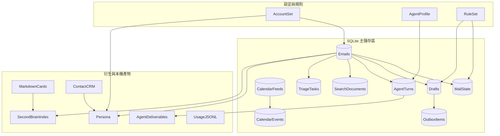

# Openinbox 資料模型文件

本目錄記錄 Openinbox／TooPowerInbox 的持久化資料、檔案格式、資料庫邏輯 schema、JSON schema、API view model 與狀態轉換。文件只描述結構、欄位語意與生命週期，不抄錄任何郵件主旨、寄件人、收件人、聯絡人、訊息內文、案件資料或其他實際資料值；即使來源是示範 fixture，也只記錄其結構。

## 1. 文件地圖

| 文件 | 內容 |
|---|---|
| [storage-overview.md](storage-overview.md) | 儲存區、檔案清單、資料所有權、刪除與備份邊界 |
| [sqlite-schema.md](sqlite-schema.md) | SQLite 資料表、欄位、索引、關聯與完整性規則 |
| [file-and-json-schemas.md](file-and-json-schemas.md) | JSON／JSONL／Markdown／ICS／EML 格式與欄位說明 |
| [state-machines.md](state-machines.md) | 同步、郵件狀態、規則、草稿、outbox、行事曆、Agent 等狀態機 |
| [api-payload-models.md](api-payload-models.md) | HTTP 與 MCP 的請求、回應及 view model |

## 2. 建模範圍

本文件涵蓋：

1. 本機設定檔：帳號、Agent 驅動與規則。
2. SQLite：郵件快取、本機郵件狀態、草稿、行事曆、搜尋索引、Agent 結果、分流任務與 outbox 紀錄。
3. 衍生資料：人格、第二大腦索引、卡片、聯絡人、技能設定與成果卡。
4. 串流與交換格式：用量 JSONL、ICS 匯入／匯出、EML 匯出。
5. 執行期狀態：供應商同步、規則套用、案件準備、Agent fallback、快取清除等。
6. HTTP API 與 MCP 工具所使用的公開資料模型。

不涵蓋：

- 實際郵件、聯絡人或案件內容。
- 憑證值、API key、密碼、認證標頭或其他秘密值。
- 供應商、瀏覽器或外部 Agent 的私有資料格式。
- 正式寄送服務；目前沒有預設啟用的對外寄送路徑。

## 3. 資料實體總覽

## 4. 資料來源優先序

同一概念若同時存在於多個位置，以下列優先序為準：

1. **SQLite**：郵件快取、狀態、草稿、索引與工作流程紀錄的執行期主來源。
2. **根目錄設定檔**：帳號、Agent 驅動及使用者規則的設定主來源。
3. **衍生 JSON**：人格與 Second Brain 索引；可由來源資料重建。
4. **Markdown／HTML 投影**：人格摘要、卡片、投影片與成果預覽；除手寫卡片外不應視為唯一主來源。
5. **API／MCP view model**：由上述來源即時組合，不直接代表物理欄位。

不應以 UI 內的暫存狀態作為持久化主來源，也不應由 API 回應反向建立資料表。

## 5. 證據與保證層級

文件欄位使用下列標記：

| 標記 | 意義 |
|---|---|
| **C — 程式確認** | 欄位或值域可由目前提供的程式碼、fixture 或測試說明直接確認 |
| **A — 架構確認** | 資料表／功能存在性由架構文件或工作狀態文件確認，但物理欄位名稱可能屬內部細節 |
| **L — 邏輯契約** | 為建立完整資料模型而整理的語意欄位；不得當成穩定外部 API，除非另有版本化契約 |

SQLite 文件中的型別是**邏輯型別**。SQLite 實際 affinity、建欄語句、索引名稱及部分內部欄位可能隨版本調整；外部整合應使用 HTTP／MCP schema，而不是依賴物理 DDL。

## 6. 核心不變量

1. **本機優先**：核心資料預設只存於本機 SQLite、JSON、Markdown 與 HTML。
2. **無預設寄送**：草稿、排程、取消、倒數與 outbox 都是本機流程；outbox 不等於已寄出。
3. **人工確認**：草稿進入本機 outbox 前需要明確確認；確認流程不得由 Agent 代替。
4. **唯讀郵箱**：IMAP 路徑使用 `EXAMINE` 與 `BODY.PEEK`，不快取遠端資料夾變更或刪除遠端郵件。
5. **秘密只存環境變數**：設定檔只保存環境變數名稱，不保存秘密值。
6. **衍生資料可重建**：人格、索引、摘要及搜尋文件必須能由來源資料重建。
7. **手寫資料優先保留**：清除衍生快取時保留草稿與使用者手寫卡片。
8. **本機覆寫不覆蓋遠端**：已讀、星號、標籤、資料夾與封存主要是本機狀態。
9. **刪除要一致**：郵件刪除時，搜尋文件、衍生狀態與相關索引也必須同步失效。
10. **不記錄內容到用量檔**：用量檔只記錄模型呼叫的計數與路由 metadata，不記提示詞、回答或秘密。

## 7. 敏感資料分級

| 級別 | 定義 | 典型資料 |
|---|---|---|
| S0 | 公開結構 | schema、欄位名稱、列舉、路由 |
| S1 | 本機操作 metadata | 帳號別名、環境變數名稱、同步時間、計數 |
| S2 | 本機內容 | 郵件標頭與內文、聯絡人、事件描述、人格、卡片、備忘 |
| S3 | 秘密值 | 密碼、API key、認證標頭、session 或其他認證秘密 |

本文件只使用 S0 與抽象的 S1 欄位名稱，不記錄 S2 實值，也不記錄任何 S3 值。

## 8. ID、日期與布林值慣例

- **ID**：使用穩定、可追蹤的字串；外部可見成果 ID 另受嚴格字元格式限制。
- **日期時間**：一般檔案使用 ISO 8601；需要顯示時保留本地時區語意。
- **行事曆時間**：同時保留本地時間字串與 IANA 時區名稱；全天事件不得被誤判為 UTC 午夜。
- **布林值**：JSON 使用 `true`／`false`；SQLite 使用 `0`／`1`。
- **空值**：`null` 表示「明確尚無值」；缺少欄位表示「沿用預設或由上層推導」，兩者不可混用。
- **集合**：JSON 陣列順序不應承載業務意義，除非欄位文件另有說明。

## 9. 維護原則

新增或變更資料模型時，應同步更新：

1. 本目錄對應 schema 文件。
2. SQLite migration 與欄位預設值。
3. API／MCP 的請求與回應契約。
4. 清除快取、備份、匯出與還原語意。
5. 測試中的假資料；不得以正式郵件或正式服務驗證。

## 10. 安全閱讀規則

- 文件中的資料型別與列舉可直接用於實作。
- 欄位值一律不得從本文件範例推定真實資料。
- 若實作與本文件不一致，應先判斷是物理內部細節變更，還是公開資料契約變更；後者需要版本化決策。
