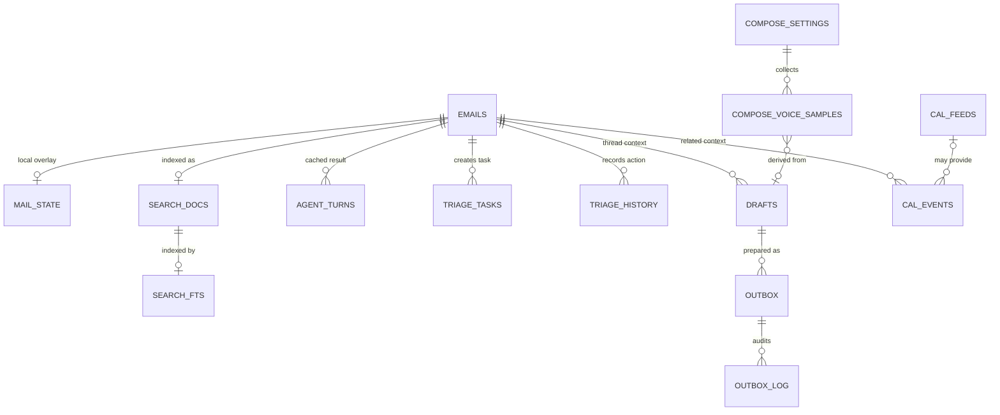

# SQLite 資料模型

## 1. 儲存引擎與命名

- 主要資料庫：`data/openinbox.db`。
- 引擎：SQLite 3，使用 Python 標準函式庫。
- 所有時間欄位以字串或整數 timestamp 保存；JSON 物件欄位以 canonical JSON 字串保存。
- 金額、附件大小等若沒有業務需求，不預先加入浮點數欄位。
- 本文件列出架構已確認的表；「邏輯欄位」不一定等同公開 API 欄位。

### 證據標記

- **C**：程式、fixture 或測試契約直接出現。
- **A**：架構或功能狀態文件直接確認該資料表／群組。
- **L**：為完整生命週期整理的邏輯欄位。

## 2. 資料表總覽

| 資料表 | 證據 | 主要內容 | 主要生命週期 |
|---|---|---|---|
| `emails` | A／C | 統一收件匣郵件快取 | 同步建立；可被清除 |
| `mail_state` | A／C | 資料夾、已讀、星號、標籤覆寫 | 隨郵件保留；可重置 |
| `drafts` | A／C | 撰寫器與 Agent 草稿 | 長期保留 |
| `events` 與相關 calendar records | A／C | 本機事件、feed 事件、邀請草稿 | 本機／匯入資料保留 |
| `cal_feeds` | A／C | 匯入行事曆來源 | 長期保留 |
| `agent_turns` | A | Agent 輸出快取 | 可由快取清除刪除 |
| `brain_fixes` | A | 使用者對 Brain 推論的修正 | 長期保留 |
| `compose_settings` | A | 語氣、風格、字型等設定 | 長期保留 |
| `compose_voice_samples` | A | 從草稿修改學習的樣本 | 長期保留 |
| `triage_tasks` | A／C | 分流待辦 | 清除後保留 |
| `triage_history` | A／C | 分流動作歷史 | 清除後保留 |
| `outbox` | A／C | 準備、排程、確認與本機 outbox 項目 | 流程保留 |
| `outbox_settings` | A | outbox 全域或單項設定 | 長期保留 |
| `outbox_log` | A | outbox 狀態轉換紀錄 | 流程保留 |
| `search_docs` | A／C | 可搜尋的郵件文件 | 隨郵件建立／刪除 |
| `search_fts` | A／C | FTS5 虛擬表 | 隨 `search_docs` 同步 |

## 3. 實體關聯

## 4. `emails`：統一收件匣郵件快取

此表保存不同供應商正規化後的郵件，不保存供應商帳號秘密。原始帳號標記必須存在，避免同名 thread 或郵件在不同帳號間互相覆蓋。

| 欄位 | 邏輯型別 | 鍵／空值 | 證據 | 說明 |
|---|---|---|---|---|
| `id` | string | 主鍵；不可空 | C | 應用內穩定郵件識別碼 |
| `account` | string | 不可空 | C | 所属帳號 key；統一收件匣篩選依此欄位 |
| `thread_id` | string | 不可空 | C | 來源 thread 識別碼；reply／follow-up 關聯依此欄位 |
| `subject` | string | 可空 | C | 正規化主旨 |
| `from_addr` | string | 可空 | C | 正規化寄件地址；顯示時仍可含個人資料 |
| `to_addr` | string | 可空 | C | 正規化收件地址集合 |
| `date_raw` | string | 可空 | C | 來源日期字串；排序另有標準化值時應另設欄位 |
| `body_text` | string | 可空 | C | 純文字內文；可能只保存部分內容 |
| `snippet` | string | 可空 | C | 列表用內文片段 |
| `category` | enum | 不可空；預設 `fyi` | C | `needs_you`、`upcoming`、`worth_a_look`、`fyi`、`other` |
| `has_attachment` | boolean | 不可空；預設 false | C | 是否存在附件或內文提及附件 |
| `source` | string | 可空 | L | `demo`、`gog`、`gsk`、`imap` 等來源 |
| `source_message_id` | string | 可空 | L | 供應商原始 ID；不可取代本機 `id` |
| `created_at` | datetime | 可空 | L | 本機快取建立時間 |
| `updated_at` | datetime | 可空 | L | 本機資料最後更新時間 |

### 不應直接放在 `emails` 的衍生欄位

- `unread`、`starred`、`folder`、`labels` 屬於 `mail_state`。
- `summary` 屬於分流／Agent 衍生結果。
- 搜尋命中片段屬於 `search_docs`／查詢 view model。
- 聯絡人統計屬於 `data/contacts.json` 或聯絡人 view model。

## 5. `mail_state`：本機郵件狀態覆寫

同步更新郵件內容時，不得以來源資料覆蓋使用者已在本機做出的已讀、星號、資料夾與標籤決策。

| 欄位 | 邏輯型別 | 鍵／空值 | 證據 | 說明 |
|---|---|---|---|---|
| `email_id` | string | 主鍵／外鍵；不可空 | C | 對應 `emails.id` |
| `folder` | enum | 不可空；預設 `inbox` | C | `inbox`、`starred`、`drafts`、`sent`、`archive`、`trash` |
| `read` | boolean | 不可空；預設 false | C | 本機已讀覆寫 |
| `starred` | boolean | 不可空；預設 false | C | 本機星號覆寫 |
| `labels` | string array／JSON | 可空 | C／L | 本機標籤；規則可新增 |
| `updated_at` | datetime | 可空 | L | 最後一次本機狀態變更 |

規則：

1. 一封信最多一個本機 state row。
2. 規則產生的標籤必須可與來源標籤區分。
3. 資料夾與星號在某些 UI 中可能同時存在；實作應定義唯一顯示語意。
4. `empty-trash` 刪除本機資料時，必須同步清除 `emails` 與搜尋文件。

## 6. `drafts`：草稿

`drafts` 同時承載 compose UI 草稿、規則產生的草稿及 Agent 產生的草稿。寄送或排程狀態由 `outbox` 管理，不應直接取代草稿。

| 欄位 | 邏輯型別 | 鍵／空值 | 證據 | 說明 |
|---|---|---|---|---|
| `id` | string | 主鍵；不可空 | C | 草稿識別碼 |
| `account` | string | 可空 | C | 草稿所屬帳號 |
| `thread_id` | string | 可空 | C | 回覆／轉寄的 thread 關聯 |
| `mode` | enum | 不可空 | C | `new`、`reply`、`forward` |
| `to_addr` | string | 可空 | C | 收件人 |
| `cc_addr` | string | 可空 | C | 副本收件人 |
| `bcc_addr` | string | 可空 | L | 密送收件人 |
| `subject` | string | 可空 | C | 主旨 |
| `body_text` | string | 可空 | C | 純文字內容 |
| `body_html` | string | 可空 | L | 選擇性 HTML 內容；不得默認信任 |
| `in_reply_to` | string | 可空 | L | 原始郵件／thread 參照 |
| `source` | enum | 不可空 | L | `manual`、`agent`、`rule`、`copilot` 等 |
| `created_at` | datetime | 不可空 | L | 建立時間 |
| `updated_at` | datetime | 不可空 | L | 最後修改時間 |

規則：

- 儲存草稿不是寄送；草稿不得因 Agent 呼叫而自動進入 outbox。
- 規則草稿需要保留來源規則 ID，才能追溯與避免重複建立。
- 語氣學習樣本只記錄必要的 before／after／diff，不應複製整份無關資料。

## 7. `events` 與行事曆相關資料

本機事件、匯入 feed 事件與邀請草稿共用 calendar domain。物理儲存可由 `events` 與相鄰記錄共同承載；外部整合應使用 calendar API，而不是猜測物理表名。

| 欄位 | 邏輯型別 | 鍵／空值 | 證據 | 說明 |
|---|---|---|---|---|
| `uid` | string | 主鍵／唯一鍵；不可空 | C | 穩定事件 UID |
| `title` | string | 可空 | C | 事件標題 |
| `start` | datetime／local datetime | 不可空 | C | 開始時間 |
| `end` | datetime／local datetime | 不可空 | C | 結束時間 |
| `tz` | string | 可空 | C | IANA 時區；無時區資料須保留語意 |
| `rrule` | string | 可空 | C | 重複規則 |
| `description` | string | 可空 | L | 事件說明 |
| `attendees` | object array／JSON | 可空 | C | 姓名、地址與 RSVP 狀態 |
| `organizer` | object／JSON | 可空 | C | 主辦者 metadata |
| `location` | string | 可空 | C | 地點文字 |
| `status` | enum | 不可空 | L | `confirmed`、`tentative`、`cancelled` 等 |
| `kind` | enum | 不可空 | L | `local`、`feed`、`invite_draft` |
| `source_feed_id` | integer／string | 可空 | L | 匯入來源 |
| `source_uid` | string | 可空 | L | 遠端 UID；與 `uid` 不可混用 |
| `created_at` | datetime | 不可空 | L | 建立時間 |
| `updated_at` | datetime | 不可空 | L | 更新時間 |

### 邀請草稿

邀請草稿是 calendar domain 的邏輯實體，欄位至少包括：

- 事件 UID 與時間。
- 主辦者、與會者及 RSVP 狀態。
- 邀請說明。
- 建立狀態。
- 可輸出的 ICS 資料。
- 建立者：使用者或 Agent。

邀請草稿只能停在草稿／準備狀態；對外寄送邀請不屬於預設資料流。

## 8. `cal_feeds`：行事曆來源

| 欄位 | 邏輯型別 | 鍵／空值 | 證據 | 說明 |
|---|---|---|---|---|
| `id` | integer／string | 主鍵；不可空 | C | 本機 feed 識別碼 |
| `name` | string | 可空 | C | 顯示名稱 |
| `url` | string | 可空 | C | 遠端來源；不得用於任意本機路徑 |
| `source_type` | enum | 可空 | L | `url`、`file`、`demo` |
| `etag` | string | 可空 | L | 增量更新 validator |
| `last_modified` | string | 可空 | L | HTTP last-modified validator |
| `last_synced_at` | datetime | 可空 | L | 上次成功同步時間 |
| `status` | enum | 不可空 | L | `active`、`error`、`disabled` |
| `last_error` | string | 可空 | L | 已正規化錯誤類別，不保存秘密 |
| `created_at` | datetime | 不可空 | L | 建立時間 |

遠端 UID 應以 `(feed_id, source_uid)` 判斷來源，避免不同 feed 的相同 UID 互相覆蓋。

## 9. `agent_turns`：Agent 結果快取

| 欄位 | 邏輯型別 | 鍵／空值 | 證據 | 說明 |
|---|---|---|---|---|
| `id` | string／integer | 主鍵；不可空 | A | 快取項目 ID |
| `cache_key` | string | 唯一；不可空 | L | 功能、來源、語言等組成的穩定 key |
| `feature` | string | 不可空 | L | `summary`、`digest`、`search_rewrite` 等 |
| `email_id` | string | 可空 | C／L | 與單封信相關時的來源 ID |
| `language` | enum | 不可空 | C | `zh`、`en` 或標準語系碼 |
| `driver` | enum | 不可空 | L | 實際使用的驅動 |
| `source_signature` | string | 可空 | L | 來源版本簽章；內容變更時使快取失效 |
| `output` | string／JSON | 可空 | L | Agent 產出；可能包含本機內容 |
| `fallback` | boolean | 不可空 | L | 是否改用本機啟發式 |
| `created_at` | datetime | 不可空 | L | 建立時間 |

現有摘要快取已知至少以郵件 ID 與語言區分；新增欄位不得破壞既有 key 邏輯。

## 10. `brain_fixes`：使用者修正

| 欄位 | 邏輯型別 | 鍵／空值 | 證據 | 說明 |
|---|---|---|---|---|
| `id` | string／integer | 主鍵；不可空 | A | 修正 ID |
| `scope` | enum | 不可空 | L | `identity`、`writing`、`habits`、`projects` 等 |
| `target_key` | string | 不可空 | L | 被修正推論的穩定 key |
| `value` | string／JSON | 可空 | L | 使用者確認內容 |
| `note` | string | 可空 | L | 說明 |
| `created_at` | datetime | 不可空 | L | 建立時間 |
| `updated_at` | datetime | 可空 | L | 更新時間 |

修正應優先於自動推論，且重建人格或摘要時仍需保留。

## 11. `compose_settings` 與 `compose_voice_samples`

### `compose_settings`

| 欄位 | 邏輯型別 | 證據 | 說明 |
|---|---|---|---|
| `scope` | string | L | 全域或帳號範圍 |
| `tone` | enum | C | `formal`、`balanced`、`casual` 等 |
| `style` | string／enum | C | 預設文風 |
| `font` | string | C | CJK 字型選擇 |
| `instruction` | string | L | 一次性寫作指示；不應永久儲存提示詞全文 |
| `updated_at` | datetime | L | 最後更新時間 |

### `compose_voice_samples`

| 欄位 | 邏輯型別 | 證據 | 說明 |
|---|---|---|---|
| `id` | string／integer | A | 樣本 ID |
| `draft_id` | string | L | 來源草稿 |
| `before` | string | C | 修改前文字 |
| `after` | string | C | 修改後文字 |
| `diff` | string／JSON | L | 計算後差異 |
| `created_at` | datetime | L | 建立時間 |

樣本可能包含 S2 內容，不應進用量檔、錯誤訊息或外部遙測。

## 12. `triage_tasks` 與 `triage_history`

### `triage_tasks`

| 欄位 | 邏輯型別 | 證據 | 說明 |
|---|---|---|---|
| `id` | string／integer | C | 任務 ID |
| `email_id` | string | C | 來源郵件 |
| `title` | string | L | 簡短任務標題 |
| `note` | string | L | 補充說明 |
| `status` | enum | L | `open`、`done`、`cancelled` |
| `due_at` | datetime | L | 可選期限 |
| `created_at` | datetime | L | 建立時間 |
| `updated_at` | datetime | L | 更新時間 |

### `triage_history`

| 欄位 | 邏輯型別 | 證據 | 說明 |
|---|---|---|---|
| `id` | string／integer | C | 歷史 ID |
| `email_id` | string | C | 來源郵件 |
| `action` | string | L | 執行的本機動作 |
| `detail` | string／JSON | L | 非敏感結果摘要 |
| `created_at` | datetime | L | 發生時間 |

分流任務與歷史在清除郵件快取後仍保留；不得因來源郵件已刪除而讓整張表失敗。

## 13. `outbox`、`outbox_settings`、`outbox_log`

### `outbox`

| 欄位 | 邏輯型別 | 證據 | 說明 |
|---|---|---|---|
| `id` | string | C | outbox 項目 ID |
| `draft_id` | string | C | 對應草稿 |
| `account` | string | L | 帳號 |
| `state` | enum | C／L | `prepared`、`scheduled`、`awaiting_confirmation`、`local_outbox`、`cancelled`、`error` |
| `scheduled_at` | datetime | L | 排程時間 |
| `prepared_at` | datetime | L | 準備時間 |
| `confirmed_at` | datetime | L | 明確確認時間 |
| `undo_until` | datetime | L | 可取消截止時間 |
| `acknowledged` | boolean | C／L | 是否取得必要確認 |
| `confirmation_ref` | string | L | 確認用不透明 reference；不得記錄秘密值 |
| `export_path` | string | L | EML 等本機匯出位置 |
| `error` | string | L | 正規化錯誤類別 |
| `created_at` | datetime | L | 建立時間 |
| `updated_at` | datetime | L | 更新時間 |

此表沒有「已由系統寄出」的預設終態；`local_outbox` 代表本機準備完成，不代表已送達收件人。

### `outbox_settings`

| 欄位 | 邏輯型別 | 證據 | 說明 |
|---|---|---|---|
| `id` | string／integer | A | 單例或範圍 ID |
| `undo_window_sec` | integer | L | 可取消倒數長度 |
| `require_confirmation` | boolean | C | 必須保持 true |
| `default_timeout_sec` | integer | L | 預設流程 timeout |
| `updated_at` | datetime | L | 更新時間 |

### `outbox_log`

| 欄位 | 邏輯型別 | 證據 | 說明 |
|---|---|---|---|
| `id` | string／integer | A | 紀錄 ID |
| `outbox_id` | string | L | 對應項目 |
| `event` | string | L | 事件名稱 |
| `from_state` | string | L | 轉換前狀態 |
| `to_state` | string | L | 轉換後狀態 |
| `detail` | string／JSON | L | 非敏感 metadata |
| `created_at` | datetime | L | 發生時間 |

## 14. `search_docs` 與 `search_fts`

### `search_docs`

| 欄位 | 邏輯型別 | 證據 | 說明 |
|---|---|---|---|
| `doc_id` | integer／string | C | 文件主鍵 |
| `email_id` | string | C | 來源郵件；每封信對應一個可搜尋文件 |
| `signature` | string | C／L | 內容簽章；變更時重建索引 |
| `subject` | string | C | 搜尋欄位 |
| `from_addr` | string | C | 搜尋欄位 |
| `body` | string | C | 正規化搜尋內容 |
| `updated_at` | datetime | L | 索引文件更新時間 |

### `search_fts`

`search_fts` 是 FTS5 虛擬表，不是第二份內容主來源。其邏輯映射至少包含：

| 邏輯欄位 | 說明 |
|---|---|
| `rowid`／`doc_id` | 對應 `search_docs` |
| `subject` | 主題索引 |
| `body` | 內文索引 |

實作使用外部內容表或 contentless table 屬物理選擇。刪除郵件時，trigger 或等價流程必須同步移除 FTS row。

搜尋降級：

- 有 FTS5 時使用 FTS。
- 無 FTS5 時使用 `LIKE`，結果相同但大型資料集效能較差。
- 中文使用重疊 bigram；單一中文字元可退回 `LIKE`。

## 15. 索引建議

下列索引是邏輯查詢需求；實際索引名稱由 migration 決定。

| 表 | 索引需求 |
|---|---|
| `emails` | `account`、`thread_id`、`category`、標準化日期 |
| `mail_state` | `email_id` 唯一；`folder`；`labels` 搜尋路徑視引擎而定 |
| `drafts` | `account`、`thread_id`、`updated_at` |
| `events` | `uid` 唯一；`source_feed_id + source_uid`；開始時間 |
| `cal_feeds` | `status` |
| `agent_turns` | `cache_key` 唯一；`email_id + feature + language` |
| `brain_fixes` | `scope + target_key` 唯一 |
| `triage_tasks` | `email_id`、`status` |
| `triage_history` | `email_id`、`created_at` |
| `outbox` | `state`、`scheduled_at`、`draft_id` |
| `outbox_log` | `outbox_id`、`created_at` |
| `search_docs` | `email_id` 唯一、`signature` |
| `search_fts` | 由 FTS5 定義 |

## 16. 完整性與交易

1. 郵件本機狀態、搜尋文件與 FTS row 的建立／刪除應放在可回復交易中。
2. 規則套用多個本機動作時，應避免只完成一半；若實作支援交易式套用，所有變更必須同一提交。
3. 草稿建立與 outbox 項目建立必須先後一致；outbox 必須引用存在的草稿。
4. 清除快取時先計算保留集合，再刪除其餘資料，避免誤刪草稿或手寫卡。
5. 外部來源同步失敗不得破壞既有快取；僅更新該帳號的最後同步狀態。
6. SQLite migration 必須可重跑，並在 migration 前備份。
