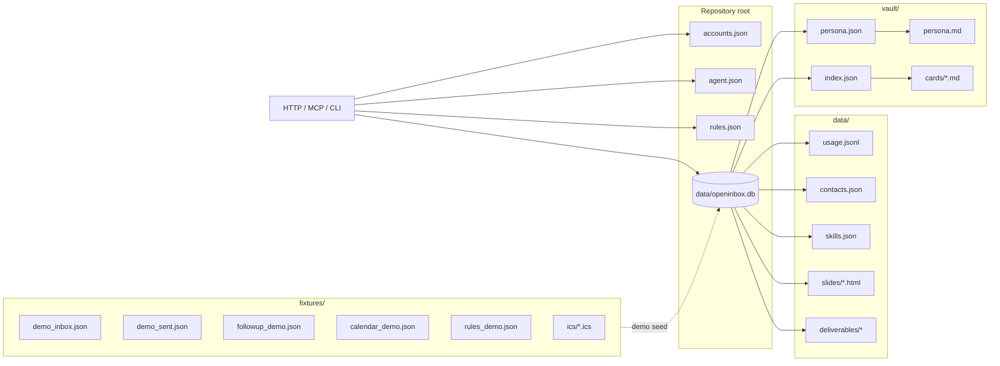
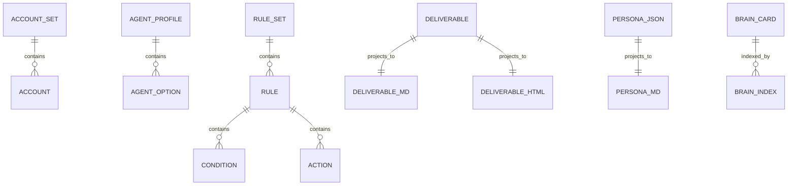

# 儲存區、檔案格式與資料所有權

## 1. 總覽

Openinbox 將資料分成「設定來源」「SQLite 主儲存區」「衍生檔案」與「來源 fixture」四層。執行時由程式根據根目錄 `OPENINBOX_ROOT` 解析路徑；預設為 repository 根目錄。

## 2. 完整檔案清單

### 2.1 根目錄設定

| 路徑 | 格式 | 生命週期 | 角色 | Git 規則 | 敏感級別 |
|---|---|---|---|---|---|
| `accounts.example.json` | JSON | 追蹤模板 | 示範模式帳號設定模板 | 追蹤 | S0 |
| `accounts.json` | JSON | 使用者本機 | 帳號、供應商、mailbox、簽名與排序 | 忽略 | S1–S2 |
| `agent.example.json` | JSON | 追蹤模板 | Agent 驅動設定模板 | 追蹤 | S0 |
| `agent.json` | JSON | 使用者本機 | 選擇本機或外部 Agent 驅動 | 忽略 | S1 |
| `rules.json` | JSON | 使用者本機 | 郵件自動規則 | 忽略 | S1–S2 |
| `rules.json.tmp` | JSON／暫存 | 原子寫入暫存 | 設定檔更新期間的中間檔 | 忽略 | S1–S2 |

`accounts.json` 與 `agent.json` 不得保存密碼、API key 或其他秘密值。秘密值只能由設定中指向的環境變數取得。

### 2.2 SQLite 與執行期資料

| 路徑 | 格式 | 生命週期 | 角色 | 清除快取時 |
|---|---|---|---|---|
| `data/openinbox.db` | SQLite 3 | 長期 | 郵件快取、狀態、草稿、索引及流程資料 | 部分保留、部分刪除 |
| `data/openinbox.db-wal` | SQLite WAL | 短期 | SQLite write-ahead log；是否出現取決於 journal mode | 隨資料庫機制 |
| `data/openinbox.db-shm` | SQLite shared memory | 短期 | SQLite 共用記憶體索引 | 隨資料庫機制 |

SQLite 是主要狀態來源；直接複製正在寫入的檔案可能不一致。正式備份應採 SQLite backup API，或停止服務後再取得一致快照。

### 2.3 `data/` 衍生檔案

| 路徑 | 格式 | 角色 | 可重建性 | 敏感級別 |
|---|---|---|---|---|
| `data/usage.jsonl` | JSON Lines | 每次模型呼叫的 token／估算用量 | 不可由其他資料重建 | S1 |
| `data/contacts.json` | JSON | 本機聯絡人 CRM | 使用者資料；不可自動重建 | S2 |
| `data/skills.json` | JSON | 技能開關與設定 | 可由設定重建 | S1 |
| `data/slides/` | HTML／必要時附 MD | 技能產生的本機投影片 | 可由技能重跑產生 | S2 |
| `data/deliverables/*.md` | Markdown | Agent 成果的可攜文字版本 | 可由同名 JSON 重建 | S2 |
| `data/deliverables/*.html` | HTML | Agent 成果的轉義預覽 | 可由同名 JSON 重建 | S2 |
| `data/deliverables/*.json` | JSON | Agent 成果的主 metadata 與文字 | 原始成果檔 | S2 |

### 2.4 `vault/` 衍生資料

| 路徑 | 格式 | 角色 | 可重建性 | 敏感級別 |
|---|---|---|---|
| `vault/persona.json` | JSON | 人格與收信習慣的主資料 | 可由郵件與 seed 重建 | S2 |
| `vault/persona.md` | Markdown | 人格的閱讀版投影 | 可由 JSON 重建 | S2 |
| `vault/index.json` | JSON | Second Brain 卡片索引 | 可由卡片重建 | S2–S1 |
| `vault/cards/*.md` | Markdown | 衍生卡片及使用者手寫筆記 | 衍生卡可重建；手寫卡不可 | S2 |
| `vault/cards/.gitkeep` | 空檔 | 保留目錄 | 不適用 | S0 |

### 2.5 追蹤的示範來源

| 路徑 | 格式 | 角色 |
|---|---|---|
| `fixtures/demo_inbox.json` | JSON | 示範收件匣郵件與人格 seed |
| `fixtures/demo_sent.json` | JSON | 示範已寄／基準郵件，供追蹤流程使用 |
| `fixtures/followup_demo.json` | JSON | 示範回覆來源，只供 demo 追蹤 |
| `fixtures/calendar_demo.json` | JSON | 示範事件、同步 metadata 與同事 feed 描述 |
| `fixtures/rules_demo.json` | JSON | 示範規則集合 |
| `fixtures/ics/*.ics` | iCalendar | 示範 feed 匯入來源 |

fixture 的值不得視為測試斷言的固定真實資料；測試應建立自己的虛構資料。

## 3. 資料所有權

| 領域 | 主來源 | 投影／衍生 | 消費者 |
|---|---|---|---|
| 帳號與供應商 | `accounts.json` | 同步狀態、provider API view | 同步器、providers UI |
| Agent 設定 | `agent.json` | context pack、Agent turn | Agent bridge |
| 郵件內容 | SQLite `emails` | inbox、搜尋、摘要、人格 | UI、搜尋、Agent |
| 郵件本機狀態 | SQLite `mail_state` | 資料夾、已讀、星號、標籤 | UI、規則 |
| 草稿 | SQLite `drafts` | outbox 項目 | compose、outbox |
| 行事曆 | SQLite calendar records | ICS、view、free/busy | calendar UI、skills |
| 規則 | `rules.json` | dry-run 預覽、規則歷史 | rules、followup |
| 人格 | `vault/persona.json` | `persona.md`、context pack | Agent、skills |
| Second Brain | `vault/cards/*.md` | `vault/index.json` | 搜尋、Agent、skills |
| 聯絡人 | `data/contacts.json` | contacts API | skills、搜尋 |
| Agent 成果 | `data/deliverables/*.json` | MD、HTML | agents UI |
| 用量 | `data/usage.jsonl` | usage API | usage UI |
| 技能設定 | `data/skills.json` | skills API | skills UI |

## 4. 檔案之間的引用

引用規則：

- 成果 JSON 的 basename 與 MD／HTML basename 相同。
- 成果 JSON 的 `id` 必須同時符合安全 ID 規則，才能用於讀取檔案。
- Second Brain 索引指向卡片相對路徑；路徑不得離開 `vault/cards/`。
- 設定檔中的路徑只允許指向受支持的資料區域；任意檔案讀取不是資料模型的一部分。
- 刪除任一投影前，必須確認對應主來源仍存在，或明確將該檔案視為孤兒資料。

## 5. 原子寫入與一致性

| 檔案／資料 | 建議寫入方式 | 一致性要求 |
|---|---|---|
| `accounts.json` | 同目錄暫存檔寫入、fsync、replace | 不可出現半份 JSON；更新前拒絕明文秘密欄位 |
| `rules.json` | 同目錄暫存檔寫入、replace | 解析失敗時保留舊版本 |
| `data/contacts.json` | 同檔原子 replace | 單一聯絡人 upsert／delete 不得破壞其他項目 |
| `data/skills.json` | 同檔原子 replace | 單一技能切換不影響其他技能 |
| `data/deliverables/*.json` | 先完成 JSON，再產生 MD／HTML | JSON 是主檔；投影失敗可由主檔重建 |
| `vault/persona.json` | 原子 replace | 成功後才重建 MD |
| `vault/index.json` | 原子 replace | 索引不得指向不存在的卡片 |
| `data/usage.jsonl` | 單行 append | 每行必須是獨立完整 JSON |

## 6. 清除快取語意

| 類別 | 清除／保留 |
|---|---|
| 郵件快取與郵件衍生索引 | 清除 |
| 示範或快取行事曆 | 可清除 |
| Agent 回合快取 | 清除 |
| 衍生人格與 Second Brain 索引 | 清除 |
| 草稿 | 保留 |
| 使用者手寫卡片 | 保留 |
| 本機建立或匯入的行事曆資料 | 保留 |
| 邀請草稿 | 保留 |
| `cal_feeds` | 保留 |
| 聯絡人、技能設定、用量 | 不屬於郵件衍生快取，原則上保留 |

`reseed` 只能重新載入 demo fixture，不應覆蓋使用者草稿、手寫卡片、聯絡人或本機設定。

## 7. 備份與還原邊界

完整備份至少應涵蓋：

- `data/openinbox.db`，以一致快照方式取得。
- `accounts.json`、`agent.json`、`rules.json`。
- `data/` 中非衍生或使用者所有的 JSON、JSONL 與產物。
- `vault/` 中的 JSON 與 Markdown 卡片。

不應把秘密值當作備份必要內容；環境變數需由使用者在還原環境另行設定。備份 manifest 應記錄檔案大小、雜湊、格式版本與建立時間，但不記錄檔案內容。

## 8. 命名與識別碼

| 類別 | 規則 |
|---|---|
| 郵件 ID | 來源內穩定；跨來源同步時由帳號與來源 ID 共同維持唯一性 |
| Thread ID | 同一帳號內穩定；不跨帳號假設相同 |
| 草稿 ID | 建立時產生；更新不應改變 |
| Calendar UID | 本機事件使用穩定 UID；feed 事件需另外保存來源與遠端 UID |
| Feed ID | 本機遞增或穩定識別碼；不得直接使用未驗證的 URL 當路徑 |
| Agent 成果 ID | 小寫英數與連字號，限制長度；拒絕分隔符與路徑片段 |
| Outbox ID | 與草稿分開；一次準備可建立可追蹤項目 |
| JSONL event ID | 可選；若有則應能唯一定位一次模型呼叫 |

## 9. 敏感度與顯示規則

- API 可顯示帳號顯示名稱、環境變數名稱、同步錯誤類別，但不得顯示秘密值。
- 搜尋、聯絡人、人格與成果 API 回傳本機內容時，應視為敏感讀取。
- 用量紀錄不得加入提示詞、回答、郵件內容或完整 HTTP 錯誤 body。
- 產出的 HTML 必須轉義內容，不載入外部資源，也不含 script 或 inline event handler。
