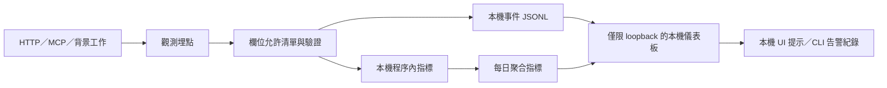

# Openinbox 可觀測性設計

> 文件狀態：設計提案。本文描述「現況盤點」與「建議方案」，不代表相關事件、指標、儀表板或告警已在程式內實作。

## 1. 目的與範圍

本文件集針對 Openinbox 的本機優先、單程序、零 pip 套件架構，設計一套可在本機運作的可觀測性方案，涵蓋：

1. 現有日誌、指標狀態與錯誤回報的盤點。
2. 關鍵事件名稱、事件結構與允許欄位。
3. 建議指標、資料維度與初始 SLO。
4. 告警條件、嚴重度、抑制規則與處置重點。
5. 本機儀表板版面。
6. 日誌及告警中禁止出現的敏感欄位清單。
7. 未來實作分階段、測試、驗收與退場計畫。

本任務只新增 `docs/fmb-observability/` 下的 Markdown 文件，不修改程式、設定、CI、部署或憑證。

## 2. 文件地圖

| 文件 | 內容 |
|---|---|
| [CURRENT-STATE.md](CURRENT-STATE.md) | 現有可觀測訊號、日誌、指標、錯誤回報與主要缺口 |
| [EVENT-CATALOG.md](EVENT-CATALOG.md) | 事件命名、通用欄位、錯誤模型與關鍵事件目錄 |
| [METRICS-SLO.md](METRICS-SLO.md) | 指標規格、標籤限制、初始 SLO 與錯誤預算 |
| [ALERTS.md](ALERTS.md) | 告警條件、嚴重度、去抖、抑制與處置重點 |
| [DASHBOARDS.md](DASHBOARDS.md) | 總覽、同步、Agent/MCP、資料安全與工作流儀表板 |
| [SENSITIVE-DATA.md](SENSITIVE-DATA.md) | 禁止欄位清單、允許欄位、留存、遮罩與測試原則 |
| [IMPLEMENTATION-PLAN.md](IMPLEMENTATION-PLAN.md) | 未來實作順序、驗收、測試、效能與退場計畫 |

## 3. 設計原則

1. **本機優先且不新增遙測**：事件與指標只寫入本機儲存空間，不預設送往遠端 collectors、錯誤追蹤 SaaS 或 webhook。
2. **零必要第三方相依**：未來實作優先使用 Python 標準函式庫。
3. **以允許清單建立事件**：只序列化已核准欄位；不能靠「先記錄、後遮罩」猜測內容是否敏感。
4. **先建立關聯，再建立漂亮圖表**：所有 HTTP、MCP、同步、Agent 與背景工作事件均須有可關聯的本機 opaque ID。
5. **低基數**：指標標籤不得使用使用者輸入、郵件主旨、聯絡人、案件、規則名稱或動態路徑。
6. **內容與觀測分離**：郵件主旨、內文、附件、搜尋詞、提示詞、回答、案件及 LINE 訊息不得進入觀測資料。
7. **錯誤可診斷但不可外洩**：只記錄穩定錯誤碼、例外類型、HTTP 狀態與重試性，不記錄原始例外訊息、CLI stderr 或上游回應本文。
8. **觀測失敗不得阻斷核心工作**：記錄或指標寫入失敗時，郵件同步、草稿與其他核心操作仍應繼續，並以健康狀態顯示降級。
9. **預設不寄送**：所有本機 outbox 與排程事件只描述本機狀態轉移，不得暗示已對外寄送。
10. **可逐步採用**：先建立事件契約，再導入請求關聯，再導入指標與告警；避免一次加入高風險的外部遙測。

## 4. 目標架構

### 4.1 建議的本機儲存位置

未來實作如需落地檔案，只能放在 repo 內已忽略的本機資料目錄，例如：

- `data/observability/events-YYYY-MM-DD.jsonl`
- `data/observability/metrics-YYYY-MM-DD.json`
- `data/observability/alerts.jsonl`

這些檔案不得提交 Git，不得包含郵件內容、個資、案件資料、LINE 訊息或任何憑證值。

## 5. 明確不做的事

- 不建立雲端帳號、遙測 SDK 或跨主機資料收集。
- 不把 `accounts.json`、`agent.json`、資料庫、vault 或任意本機檔案送至外部服務。
- 不記錄 HTTP request/response body、完整 URL、header、cookie 或原始上游回應。
- 不以郵件主旨、寄件人、收件人、聯絡人、案件或搜尋詞作為指標標籤。
- 不以「郵件 ID」或「成果卡片 ID」直接作為安全的 correlation ID；目前部分 ID 可能包含可識別資料。
- 不新增任何對外寄送路徑，也不把 outbox 轉移命名為已寄送事件。

## 6. 建議採用順序

1. 先核准事件欄位允許清單與錯誤碼。
2. 再加入本機事件 emitter 與請求 correlation ID。
3. 接著覆蓋同步、Agent、MCP、索引與背景工作。
4. 最後建立本機儀表板、告警規則與 SLO 基線。
5. 經過一段實際本機使用後，再由 BOB 調整門檻與留存期限。

相關決策與未完成項目見 [IMPLEMENTATION-PLAN.md](IMPLEMENTATION-PLAN.md)。
