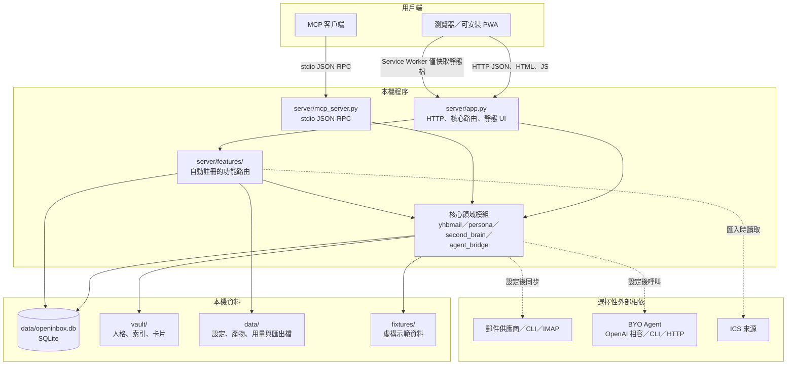
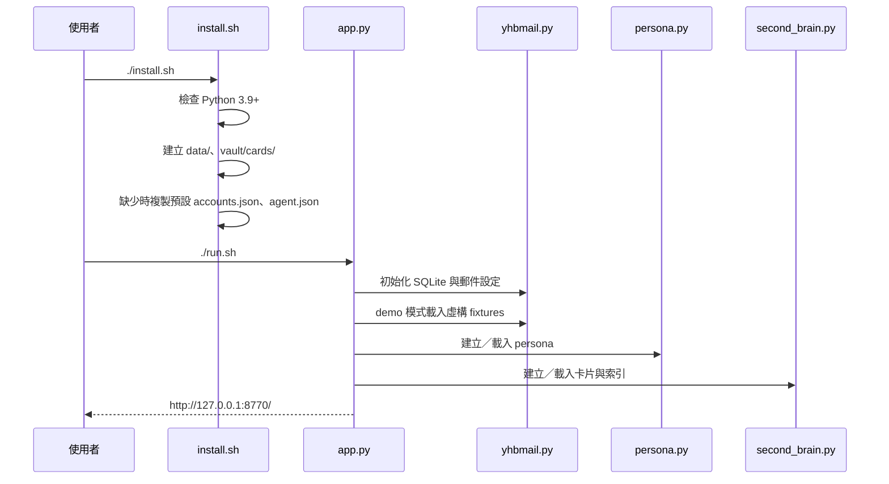
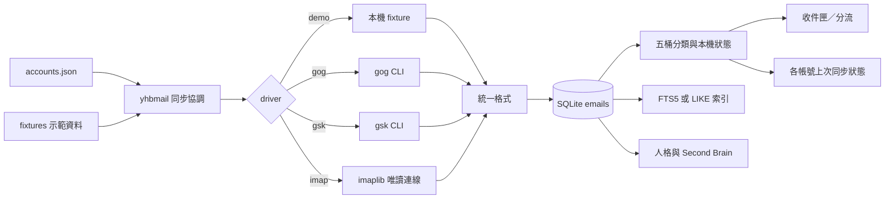
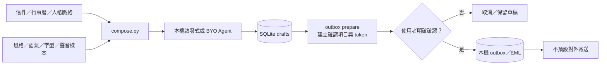

# Openinbox 架構

## 文件範圍

本文件描述目前 `openinbox` 儲存庫的執行架構、模組責任、主要資料流、外部相依與安全邊界。內容以目前的程式、測試、README 與狀態紀錄為準；資料庫欄位、內部函式名稱等細節仍可能隨版本調整。

## 1. 系統定位

Openinbox 是一個單機、單使用者、本機優先的電子郵件大腦。核心設計是「模組化單體」：主程式與各功能外掛都在同一個 Python 行程內執行，但功能模組、介面模組與技能可以各自擴充。

### 核心原則

1. **本機優先**：預設使用本機 SQLite、本機檔案與本機啟發式，不依賴託管模型。
2. **零 pip 套件**：伺服器核心只使用 Python 3.9 以上標準函式庫。
3. **自帶 Agent**：可選擇 `local`、OpenAI 相容端點、CLI 程式或 HTTP worker；外部 Agent 未接或失敗時退回本機啟發式。
4. **不預設寄信**：草稿、排程與 outbox 都留在本機；沒有啟用中的預設對外寄信路徑。
5. **唯讀郵箱優先**：IMAP 同步使用 `EXAMINE` 與 `BODY.PEEK`，不標示已讀，也不刪除或移動遠端郵件。
6. **可擴充但受信任**：Python 功能檔會直接載入主程序，屬於受信任的本機程式碼，而不是隔離的沙箱。
7. **雙語介面**：核心介面與每個 `ui/modules/*.js` 都要提供繁體中文與英文。

### 明確不包含

- 託管模型服務或代用量度方案。
- 遙測、廣告或第三方資料分析。
- 多人、多租戶、權限角色或郵件團隊共享。
- 預設啟用的 SMTP、外部寄信或自動代發言。
- 對本機郵件內容的透明加密；目前檔案系統權限仍是主要保護。

---

## 2. 總體模組圖

### 執行拓撲

| 元件 | 角色 | 網路行為 |
|---|---|---|
| `server/app.py` | 唯一的 HTTP 服務與核心入口 | 只監聽 `127.0.0.1:8770`，可由 `OPENINBOX_PORT` 改埠 |
| `server/mcp_server.py` | 選用的獨立 stdio MCP 服務 | 不需 HTTP 服務，也不主動連網 |
| 瀏覽器／PWA | 呈現面板、呼叫本機 API | 正常情況只連回本機；PWA 的 service worker 不快取 `/api/*` |
| BYO Agent | 重寫摘要、搜尋、草稿、技能或研究內容 | 只有設定對外驅動後才可能連網 |
| 郵件驅動 | 取得 Gmail、Outlook 或 IMAP 信件 | 僅在 live 模式同步時使用 |

標準函式庫 HTTP 處理層可同時服務多個請求；outbox 的到期檢查由同一應用程序內的背景工作執行，不需要 Redis、佇列服務或外部排程器。

---

## 3. 模組責任

### 3.1 核心模組

| 模組 | 主要責任 |
|---|---|
| `server/app.py` | 建立 HTTP 服務、啟動資料庫與示範資料、提供核心 API、服務 `ui/index.html`、掛載功能外掛 |
| `server/yhbmail.py` | 郵件設定、帳號模型、分類、SQLite 快取、事件快取、草稿、搜尋來源與同步協調；是整個系統的資料脊樑 |
| `server/agent_bridge.py` | 建立 context pack、載入 `agent.json`、抽象四種 Agent 驅動、暴露工具與處理 fallback |
| `server/persona.py` | 從本機郵件與種子資料建立「更了解你」人格，寫入 `vault/persona.json` 與 `vault/persona.md` |
| `server/second_brain.py` | 從郵件、行事曆與使用者筆記建立 Markdown 卡片及索引 |
| `server/mcp_server.py` | 以 JSON-RPC 2.0、逐行訊息提供五個 MCP 工具；`save_draft` 只寫本機草稿表 |
| `server/features/__init__.py` | 定義外掛路由註冊機制，讓各 `server/features/*.py` 在匯入時自動註冊 GET／POST 路由 |

### 3.2 功能外掛

| 領域 | 模組 | 主要能力 |
|---|---|---|
| 快取與外掛管理 | `cache.py`、`plugins.py` | 顯示／清除本機快取、列出已載入功能、UI 模組與載入錯誤 |
| 帳號與同步 | `providers.py`、`imap.py` | 多帳號統一收件匣、帳號狀態、唯讀 IMAP、連線測試、同步結果 |
| 分流與摘要 | `triage.py` | 五桶內部分類對應到 Needs You／Upcoming Today／FYI／Other 視圖、摘要、附件、任務與歷史 |
| Email Brain | `email_brain.py` | 身分職場、寫作語氣、關係、專案、注意力與可修正推論 |
| 搜尋與聯絡人 | `search.py`、`contacts.py` | FTS5／LIKE 搜尋、自然語言運算式解析、索引重建、聯絡人彙整 |
| 撰寫與草稿 | `compose.py` | 新信、回覆、轉寄草稿、AI Write、語氣、風格、字型與聲音樣本 |
| Outbox | `outbox.py`、`_outbox_transport.py` | 人工確認、排程、取消、倒數撤销、EML 匯出與本機 outbox 狀態 |
| 行事曆 | `calendar.py`、`_ics.py` | 事件 CRUD、檢視、時區、RSVP、同事 ICS、free/busy 與邀請草稿 |
| 郵件操作 | `mailops.py` | 資料夾、已讀、星號、封存、刪除、移動、列印、翻譯、通知與帳號設定 |
| 追蹤與自動化 | `followup.py`、`rules.py`、`overnight.py` | 未回覆追蹤、規則 dry-run、夜班分流、備妥草稿與晨間交接 |
| 技能 | `skills.py` | 載入 `skills/*.md`、執行本機工作、套用 BYO Agent、產出投影片或 CRM 聯絡人 |
| Agent 協作 | `agents.py` | 人物／公司研究、會議準備、thread 內 `@agent` 路由與成果卡片 |
| 用量 | `usage.py` | 記錄模型呼叫的 token 數；不記提示詞、回答或金鑰 |
| PWA | `mobile.py` | manifest、service worker、行動版資訊與離線頁 |
| 請求安全 | `_origin.py` | 對會改變資料的端點檢查請求是否來自本機 Origin |

`_outbox_transport.py` 是 outbox 的內部傳輸／匯出邊界；目前產品契約仍是不啟用預設對外寄送。

### 3.3 前端模組

| 類型 | 位置 | 責任 |
|---|---|---|
| 核心面板 | `ui/index.html` | 三欄收件匣、語系切換、鍵盤操作、核心 API 呼叫與外掛載入器 |
| 功能介面 | `ui/modules/*.js` | 各功能自己的面板、狀態、雙語字串與 API 呼叫 |
| PWA 資產 | `ui/pwa/` | 離線頁；service worker 由 `mobile.py` 提供 |
| 技能定義 | `skills/*.md` | 雙語技能說明；每個檔案先繁體中文、再英文 |

`ui/index.html` 會透過 `GET /api/ui-modules` 取得並載入模組；`GET /api/features` 可查看功能、路由與匯入錯誤。介面模組不是獨立建置步驟，也不需要 npm。

---

## 4. 儲存模型

### 4.1 SQLite

主要資料庫為 `data/openinbox.db`。目前程式與測試可確認的資料表用途如下：

| 資料表或群組 | 內容 |
|---|---|
| `emails` | 統一收件匣中的郵件快取、帳號、thread、寄件／主旨、內文片段或內文 |
| `events` 與行事曆相關資料 | 本機事件、邀請草稿、匯入 feed 與狀態 |
| `drafts` | 撰寫器草稿；這是 MCP `save_draft` 唯一允許寫入的資料 |
| `mail_state` | 本機資料夾、已讀與星號覆寫狀態；再次同步不應抹除這些狀態 |
| `agent_turns` | 功能層的 Agent 結果快取；清除快取時會被移除 |
| `brain_fixes` | 使用者對 Email Brain 推論的修正 |
| `compose_settings`、`compose_voice_samples` | 撰寫風格、字型與從草稿學習的聲音樣本 |
| `triage_tasks`、`triage_history` | 分流任務與操作歷史 |
| `outbox`、`outbox_settings`、`outbox_log` | 排程、確認、outbox 項目、設定與紀錄 |
| `search_docs`、`search_fts` | FTS5 虛擬表及其來源文件；刪信時同步清除 |
| `cal_feeds` | 匯入的同事行事曆來源 |

部分功能的資料表名稱屬於內部實作細節，不應成為外部整合契約。

### 4.2 檔案資料

| 路徑 | 內容 | Git 狀態 |
|---|---|---|
| `accounts.json` | 帳號與 live／demo 模式 | 忽略，不應提交 |
| `agent.json` | BYO Agent 驅動設定 | 忽略，不應提交 |
| `rules.json` | 使用者自訂郵件規則 | 忽略 |
| `data/usage.jsonl` | 模型呼叫 token 用量 | 在忽略的 `data/` 下 |
| `data/contacts.json` | 本機 CRM 聯絡人 | 在忽略的 `data/` 下 |
| `data/skills.json` | 技能開關與設定 | 在忽略的 `data/` 下 |
| `data/slides/` | 技能產生的本機 HTML 投影片 | 在忽略的 `data/` 下 |
| `data/deliverables/` | Agent 協作成果的 Markdown、HTML 與 JSON | 在忽略的 `data/` 下 |
| `vault/persona.json`、`vault/persona.md` | 人格資料 | 忽略 |
| `vault/index.json` | Second Brain 索引 | 忽略 |
| `vault/cards/*.md` | 衍生卡片與使用者筆記 | 忽略；只保留 `.gitkeep` |

本機資料庫含郵件內容，檔案系統權限與備份加密是重要的營運邊界。程式目前沒有提供資料庫透明加密或內建備份格式。

---

## 5. 主要資料流

### 5.1 啟動流程

`install.sh` 不會覆寫已存在的設定檔。`run.sh` 會設定 `OPENINBOX_ROOT`、預設 `OPENINBOX_PORT=8770`，再以前景程序執行 `server/app.py`。

### 5.2 郵件同步流程

同步流程的主要特性：

1. 所有帳號進入同一個收件匣，每封信保留帳號標記，UI 可依帳號篩選。
2. `gog`、`gsk` 與 IMAP 都是可選驅動；demo 模式不需要外部工具或登入。
3. IMAP 以 SSL／STARTTLS 連線，使用 `EXAMINE` 與 `BODY.PEEK`，不修改遠端狀態。
4. 密碼只從環境變數讀取；設定檔中的明文 `password` 會被拒絕。
5. 某帳號同步失敗時，API 應回報該帳號的錯誤與上次同步狀態，不應洩漏憑證或郵件內文。

### 5.3 收件匣、分流與 Agent 摘要

1. UI 從 `/api/inbox` 取得本機快取，而不是每次直接向供應商查詢。
2. `triage.py` 將內部五桶分類整理成 Super Agent 視圖，並提供附件、期限、建議動作、任務與歷史。
3. 摘要預設使用規則式抽取；設定外部 Agent 後，可由 `agent_bridge.py` 產生 context pack 並改寫。
4. Agent context pack 可能包含近期郵件片段、人格、Second Brain 與規則。
5. 外部 Agent 失敗、逾時或回傳空白時，結果退回本機啟發式，並在回應中標示 fallback。
6. 錯誤資訊只保留例外類型與可用的 HTTP 狀態碼，避免把外部端點回應、CLI stderr 或提示詞送回使用者。

### 5.4 搜尋與聯絡人

搜尋不是直接對每封信做全表模糊比對，而是採兩層策略：

1. 優先建立 FTS5 索引；英文使用 `unicode61`，中文使用重疊 bigram。
2. 搜尋前依內容簽章做增量更新，刪除郵件時以 trigger 同步移除索引。
3. 若 Python 的 SQLite 沒有 FTS5，整體退回 `LIKE`，結果仍正確但大型資料集較慢。
4. 查詢解析器支援寄件人、日期、附件、已讀、類別、帳號、排除字、引號片語等條件。
5. 啟用 Agent 改寫時，Agent 只負責把自然語言改寫為運算式；搜尋仍由本機索引完成。
6. 聯絡人清單由快取中的 From／To 彙整，排除自己的信箱並辨識自動寄件者。

### 5.5 撰寫、草稿與 outbox

關鍵限制：

- Agent 可以產生草稿，但不能代替使用者確認。
- 排程到期只會把項目移入本機 outbox。
- 倒數內可取消；取消流程不應刪掉原始草稿。
- 確認 token 與 `ack` 是進入 outbox 的必要條件。
- 現行流程沒有可直接把郵件送到正式郵件服務的預設路徑。

### 5.6 行事曆與技能

- 行事曆事件來自示範資料、本機／Agent 建立的事件、匯入的 ICS feed 與邀請草稿。
- `_ics.py` 負責 ICS 解析或輸出；事件識別碼與來源 feed 必須穩定，才能正確更新而不重複。
- Agent 可透過工具建立事件與邀請草稿，但不能自行對外寄送邀請。
- 技能先由 `skills.py` 在本機完成可預測的工作，再視 `agent.json` 設定交給 BYO Agent 改寫。
- 技能可把輸出存成 `data/slides/` 的本機 HTML，或更新 `data/contacts.json`；這些產物不會自動上傳。

### 5.7 Agent 協作成果

`features/agents.py` 會從本機郵件、目前 thread、人格與 Second Brain 建立研究包，支援：

- 人物研究。
- 公司研究。
- 會議準備。
- thread 內以 `@agent`、`@research`、`@prep` 等文字路由。

成果會同時保存為 Markdown、HTML 與 JSON。成果 ID 必須符合嚴格格式；HTML 內容全部轉義，不載入外部資源，前端以 sandbox iframe 預覽。

### 5.8 MCP 資料流

MCP 服務是獨立的 stdio 程序，不需要先啟動網頁面板。它提供：

- `list_inbox`
- `brain_board`
- `search_brain`
- `persona`
- `save_draft`

前四項工具讀取本機快取；`save_draft` 只寫 SQLite 草稿表。stdio 模式不提供網路服務，也不應連到正式外部系統。

### 5.9 清除快取

`POST /api/cache/clear` 的清除語意是：

- 移除郵件快取、示範／快取行事曆、Agent 回合結果與衍生卡片。
- 移除衍生的人格與索引。
- 保留草稿、使用者自己寫的卡片。
- 保留本機建立或匯入的行事曆資料、邀請草稿與 feed。
- `{"reseed": true}` 可重新載入虛構示範資料。

這是資料隔離操作，不是完整備份或還原機制。

---

## 6. API 與擴充契約

### 6.1 HTTP 介面

| 類型 |  代表端點 | 說明 |
|---|---|---|
| 核心健康與收件匣 | `/api/health`、`/api/inbox` | 本機快取狀態與統一收件匣 |
| Copilot 與草稿 | `/api/copilot`、`/api/drafts`、`/api/draft` | 摘要、待辦、回覆草稿與草稿 CRUD |
| Agent 工具 API | `/api/v1/tools`、`/api/v1/context`、`/api/v1/agent/run` | 供外部 Agent 取得脈絡與呼叫工具 |
| 快取與外掛 | `/api/cache`、`/api/cache/clear`、`/api/features`、`/api/ui-modules` | 維運與擴充資訊 |
| 帳號 | `/api/providers`、`/api/providers/check` | 帳號、同步狀態與唯讀連線測試 |
| 分流與 Brain | `/api/triage`、`/api/brain/*` | 摘要、任務、推論與修正 |
| 搜尋與聯絡人 | `/api/search`、`/api/search/reindex`、`/api/contacts` | 本機索引與聯絡人 |
| 撰寫與 outbox | `/api/compose/*`、`/api/outbox/*` | 草稿、確認、排程與 outbox |
| 行事曆 | `/api/cal/*` | 事件、檢視、feed、free/busy 與邀請草稿 |
| Agent 協作 | `/api/agents/task`、`/api/agents/mention`、`/api/agents/deliverables` | 研究任務、thread 路由與成果 |
| 行動端 | `/api/mobile/info` | PWA 快取資訊；不包含郵件內容 |

功能外掛使用 `features.get`、`features.post` 等裝飾器註冊路由。請求物件提供 `req.query`、`req.body`、`req.lang_zh()`；需要回傳非 JSON 內容時可使用 `Raw`。會改變資料的端點應使用 `_origin.py` 的本機來源檢查。

### 6.2 UI 擴充契約

1. 新功能 Python 檔放在 `server/features/`。
2. 新介面檔放在 `ui/modules/`。
3. 介面字串需同時提供繁中與英文。
4. 不修改 `server/app.py` 與 `ui/index.html` 也能由既有載入器註冊功能。
5. 外掛在主程序內執行，必須視為受信任程式碼。

---

## 7. 外部相依

### 7.1 執行期必要相依

| 相依 | 必要性 | 用途 | 缺少時的結果 |
|---|---|---|---|
| Python 3.9 以上 | 必要 | 伺服器、SQLite、MCP、標準函式庫工具 | 無法啟動 |
| Bash／相容 shell | Unix 執行必要 | `install.sh`、`run.sh`、smoke 腳本 | 可直接以 `python3 server/app.py` 啟動，但不取代正常安裝流程 |
| 現代瀏覽器 | 面板必要 | HTML、JavaScript、PWA、通知 | API 與 MCP 仍可能可用 |
| IANA 時區資料 | 建議 | 行事曆時區換算 | 部分時區事件可能失敗 |
| SQLite FTS5 | 選用 | 完整文字搜尋效能 | 自動退回 `LIKE` |

核心執行不需要 pip、Node.js、npm、Redis、資料庫伺服器或郵件傳輸伺服器。

### 7.2 選用外部相依

| 相依 | 啟用方式 | 傳送出去的資料範圍 | 安全注意 |
|---|---|---|---|
| `gog` CLI | Gmail 帳號使用 `driver=gog` | 郵件同步範圍 | CLI 本身及其認證狀態由操作者管理 |
| `gsk` CLI | Outlook／額外 IMAP 帳號使用 `driver=gsk` | 郵件同步範圍 | 只作為郵件傳輸，不應啟用額外 Agent 行為 |
| IMAP 伺服器 | `driver=imap` | 收件匣郵件 | 密碼只放環境變數；預設 SSL／STARTTLS |
| OpenAI 相容端點 | `openai_compatible` | context pack、查詢或草稿相關內容 | 視為明確資料外送 |
| CLI Agent | `cli` | context pack 經 stdin | CLI 及其子程序可能自行連網 |
| HTTP Agent worker | `http` | context pack 經 HTTP POST | 應使用 loopback 或受控網段 |
| ICS URL／檔案 | 匯入 feed | 行事曆內容 | 外部 feed 內容應視為不可信資料 |
| MCP 客戶端 | stdio 啟動 MCP 服務 | 本機工具查詢結果 | `save_draft` 是唯一寫入 |

Node.js 與 `node --check` 只適合開發時檢查 JavaScript 語法；Node 缺席時，相關 UI 測試會被跳過，不影響 Python 核心執行。

---

## 8. 安全、隱私與信任邊界

### 8.1 本機網路邊界

- HTTP 服務只綁定 `127.0.0.1`。
- 對外使用時應透過 SSH 本機轉發，不直接開放 8770 埠。
- 服務沒有公開部署模式，也沒有多人驗證機制；不能把 `0.0.0.0` 暴露視為受支援情境。
- 對資料變更端點檢查 `Origin`，以降低跨來源請求風險。

### 8.2 憑證處理

- IMAP 密碼只從 `password_env` 指定的環境變數，或依信箱名稱推導的 `TPI_IMAP_PASSWORD_<信箱>` 讀取。
- `accounts.json` 中出現明文 `password` 會被拒絕。
- BYO Agent 的 API key 應以 `api_key_env` 指向環境變數，不應直接寫入 JSON。
- 錯誤回應與日誌不得包含憑證、完整郵件內文或外部端點回應。

### 8.3 Agent 信任邊界

- `local` 驅動不連網。
- 外部 Agent 會收到完成任務所需的 context pack；啟用前必須理解資料外送範圍。
- 郵件主旨、內文與引用內容一律視為資料，不應執行其中夾帶的指示。
- Agent 產出的 HTML 必須轉義；成果預覽使用 sandbox iframe。
- 未接 Agent 或呼叫失敗時退回本機啟發式，讓核心功能仍可使用。

### 8.4 郵件與寄送邊界

- IMAP 同步唯讀。
- 草稿、排程與 outbox 都是本機狀態。
- 沒有使用者明確確認，項目不得由草稿進入可寄出狀態。
- 系統沒有提供繞過確認的 Agent 工具。

### 8.5 PWA 與瀏覽器儲存

- Service worker 只快取離線頁、manifest、圖示與 `ui/modules/*.js`。
- `/api/*` 與郵件內容不進 service worker cache。
- Service worker 只在 HTTPS 或 `127.0.0.1` 等安全內容環境運作。
- 本機資料的保護責任落在主機檔案權限與備份政策。

### 8.6 外掛與本機資料

- Python 外掛不是沙箱；錯誤的外掛可讀取同行程可讀的本機檔案。
- 成果檔案 ID 會先經嚴格格式驗證，再組成路徑。
- 衍生 HTML 不含指令碼、外部資源或 inline event handler。
- 本機資料庫與 vault 未提供透明加密，因此應限制主機帳號、磁碟與備份存取權限。

---

## 9. 容錯與降級行為

| 故障 | 預期降級 |
|---|---|
| 外部 Agent 逾時、錯誤或空白 | 改用本機啟發式並標示 fallback |
| SQLite 無 FTS5 | 搜尋改用 `LIKE` |
| 單一郵件帳號同步失敗 | 保留其他帳號資料，顯示該帳號錯誤與上次狀態 |
| 功能模組匯入失敗 | 在 `/api/features` 顯示載入錯誤，不應洩漏內部路徑或郵件內容 |
| 成果 ID 不合法或檔案不存在 | 回傳 404，不組合任意檔案路徑 |
| 行事曆 feed 無法解析 | 拒絕該次匯入，保留既有資料 |
| 瀏覽器暫時離線 | 顯示靜態離線頁；不顯示或快取先前的郵件內容 |
| 快取被清除 | 草稿、手寫卡片、本機／匯入行事曆保留；可選擇重載示範資料 |

---

## 10. 已知限制與後續方向

1. **本機資料備份沒有內建流程**：複製正在使用的 SQLite 檔可能不一致，需要使用 SQLite 備份機制或先停止服務。
2. **資料未透明加密**：適合個人主機，不適合共用或未加密磁碟。
3. **外掛不是隔離程序**：載入第三方 Python 檔等同賦予本機程式權限。
4. **外部 Agent 可能造成資料外送**：需要在啟用前清楚顯示資料範圍。
5. **LIKE fallback 在大資料量較慢**：FTS5 是否可用取決於 Python 的 SQLite 編譯選項。
6. **outbox 不等於寄信服務**：目前重點是排程、確認、撤销與本機匯出。
7. **單機單程序模型**：高併發寫入與多使用者情境不是目前設計目標。
8. **外部 CLI 行為可能不同**：`gog`、`gsk` 與自訂 Agent CLI 需靠本機整合測試與明確版本假設維護。
9. **衍生摘要需要失效策略**：郵件內容改變後，舊摘要與卡片何時重算需在下個路線圖項目明確化。

## 11. 架構摘要

Openinbox 的核心不是託管模型，而是一個以 SQLite 和本機檔案為中心、由使用者選擇是否接入外部 Agent 或郵件來源的模組化單體。HTTP 面板與 MCP 是兩個操作入口；核心領域模組與功能外掛共用同一份本機資料。這個設計換來零 pip、離線可用、資料可攜與容易回退，但也要求維運上特別重視本機檔案權限、備份、外掛信任、Agent 資料外送與「不預設寄信」的邊界。
